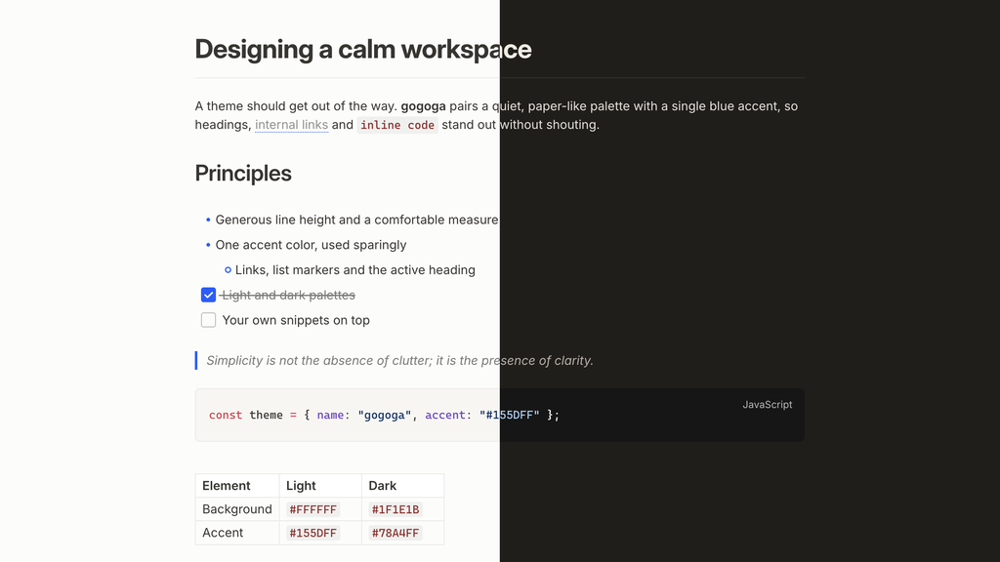

# gogoga

[English](https://github.com/JackWeiGogoga/gogoga-theme/blob/main/README.md) | **简体中文**

**官网：**[obsidian.gogoga.top](https://obsidian.gogoga.top/theme/)，截图、可以直接上手点的在线体验和下载。



一款复刻 [Tolaria](https://github.com/refactoringhq/tolaria) 设计语言的
Obsidian 主题：Notion 风格的浅色配色、暖炭灰深色配色、`#155DFF` 强调色、
Inter 字体、蓝色列表符号，以及把 H1 当作标题、下方带分隔线的版式。

## 特性

- **两套配色**，移植自 Tolaria 的设计 token：浅色（白底 `#37352F` 文字，
  侧边栏 `#F7F6F3`）和暖色深色（`#1F1E1B` 底 `#E6E1D8` 文字），强调色
  `#155DFF` / `#78A4FF`。强调色跟随「设置 → 外观 → 强调色」，不装插件也能换成自己喜欢的颜色
- **编辑区排版**：Inter 字体，15px/1.5 字号体系，740px 行宽，沿用 Tolaria
  的标题字号阶梯（32/27/20/17）并带负字距，H1 和行内标题下方有分隔线
- **细节**：蓝色列表符号、18px 复选框、点状下划线的双链、带强调色边栏的引用块、
  近乎纯黑的深色代码块、低调的灰色属性标签
- **Notebook Navigator 适配**：通过插件的 `--nn-theme-*` API，完整美化
  [Notebook Navigator](https://github.com/johansan/notebook-navigator)
  插件的笔记列表——通栏行、Tolaria 风格的选中态、低调的标签胶囊
- **配套插件**：
  [`gogoga-icons`](https://github.com/JackWeiGogoga/gogoga-icons) 把 Obsidian
  的 Lucide 界面图标替换为 Phosphor（Tolaria 使用的图标集）；
  [`gogoga-outline`](https://github.com/JackWeiGogoga/gogoga-outline) 在编辑区边缘固定一条
  Codex 风格的标题导轨——光标经过时刻度像程序坞一样波浪式隆起，支持章节预览和点击跳转；
  [`gogoga-youtube`](https://github.com/JackWeiGogoga/gogoga-youtube) 基于公开 RSS
  订阅源管理分组的 YouTube 频道订阅、最新上传、已读状态和可选的视频笔记，并自动生成原生
  Bases 视图。
- **支持 Style Settings**：可调强调色（另有悬停时的「强调色（悬停态）」）、行内代码、标题和斜体颜色（浅色/深色分别设置）、正文字体、正文字重、
  加粗样式（经典 / 强调色 / 荧光笔，可自定义加粗颜色、粗细和笔画加粗）、正文行宽、表格最小列宽，以及「隐藏一级标题下方的分隔线」「统一嵌套列表符号」
  「使用系统字体渲染」（仅 macOS）「悬停行强调」（可单独设底色）「标题等级标记」「聚焦模式」六个可选开关。聚焦模式下写作时只有光标所在的段落保持清晰，其余内容变淡；阅读视图里跟随鼠标所在的段落。所有开关默认关闭，所以不装该插件时主题也保持预期的默认效果。选项文字跟随 Obsidian 的语言设置，支持简体中文和英文。
- **荧光笔记**（Style Settings → gogoga → 荧光笔记，每项默认关）：笔记标题和一级标题压在马克笔色块上、二三级标题下半截刷一道荧光笔、`==高亮==` 两头斜着收尾像荧光笔划过、`<u>下划线</u>` 换成粗记号笔线、删除线变成红线划掉；五项可单独开，荧光笔颜色可换，深色模式下同样适用。
- **更多外观选项**（Style Settings → gogoga，每项默认关）：
  - 标题配色：彩虹、海洋、森林、暮色几套方案，也可以单独设某一级标题的颜色。
  - 多彩强调：斜体、粗斜体各有颜色，斜体高亮、加粗高亮、粗斜体高亮各有底色。
  - 任务与列表：圆形复选框；`- [>]` `- [!]` `- [?]` 等 21 种任务状态各有图标和颜色；彩虹缩进线。
  - 文件列表：按类型显示文件图标；文件夹图标用强调色或彩虹色。
  - 笔记属性字号可调。
- **写作辅助不装插件也能用**：聚焦模式、悬停行强调、标题等级标记除了 Style Settings 开关，
  也可以用 Obsidian 自带的功能开启，见[下文](#写作辅助)。
- **原生文件管理器也是 Tolaria 风格**：用文件夹图标代替折叠箭头，行高、缩进和 Tolaria 一致，
  展开的文件夹下有一条对准图标的连接线，不装 Notebook Navigator 也好看。

## 安装

### 主题市场（推荐）

设置 → 外观 → 主题 旁边点「管理」，搜索 **gogoga**，安装后点「使用」。以后有新版本也在这里更新。

### 手动安装

不能联网（比如公司内网）、或者想装指定版本时用：

1. 打开 [Releases 页面](https://github.com/JackWeiGogoga/gogoga-theme/releases/latest)，在 **Assets** 里下载 `theme.css`、`manifest.json` 这两个文件。**不要下载 Source code 压缩包**：那是源码，Obsidian 用不了。
2. 打开你的库（vault）所在文件夹，进到 `.obsidian/themes/`（没有就新建），新建一个叫 `gogoga` 的文件夹，把两个文件放进去，最后是 `<库>/.obsidian/themes/gogoga/theme.css` 这样的路径。
   - `.obsidian` 是隐藏文件夹：macOS 在访达里按 `⌘ ⇧ .` 显示；Windows 在资源管理器的「查看」里勾选「隐藏的项目」。
3. 重启 Obsidian，在 设置 → 外观 → 主题 里选 **gogoga**。


### 推荐配置

- 在本地安装 [Inter](https://rsms.me/inter/) 字体（否则主题会回退到系统字体）。
- 把基础字号设为 **15px**（设置 → 外观），与 Tolaria 编辑区的字号体系一致；
  标题字号都是相对这个基础字号计算的。
- 想要 Tolaria 的三栏布局，请安装 Notebook Navigator 和配套插件
  [gogoga-icons](https://github.com/JackWeiGogoga/gogoga-icons)。

### 写作辅助

- **聚焦模式**：写作时只有光标所在的段落保持清晰，其余内容变淡；阅读视图里跟随鼠标所在的段落。
- **悬停行强调**：鼠标所在的行（段落）带一层淡淡的强调色底。
- **标题等级标记**：在每个标题左侧的空白处显示一个小小的 H1–H6 标记。

开启方式如下，前两种不需要任何插件：

1. **按篇开启**：在笔记属性里加上 Obsidian 自带的 `cssclasses`，比如只在写长文时聚焦：

   ```yaml
   ---
   cssclasses: [gogoga-focus, gogoga-hover, gogoga-heading-level]
   ---
   ```

2. **全局开启**：把
   [`snippets/gogoga-focus-mode.css`](https://github.com/JackWeiGogoga/gogoga-theme/blob/main/snippets/gogoga-focus-mode.css)、
   [`snippets/gogoga-hover-highlight.css`](https://github.com/JackWeiGogoga/gogoga-theme/blob/main/snippets/gogoga-hover-highlight.css)、
   [`snippets/gogoga-heading-level.css`](https://github.com/JackWeiGogoga/gogoga-theme/blob/main/snippets/gogoga-heading-level.css)
   中需要的复制到 `<vault>/.obsidian/snippets/`，然后在 设置 → 外观 → CSS 代码片段 里打开。
3. **Style Settings**：gogoga → 特性开关 → 悬停行强调 / 标题等级标记 / 聚焦模式。
4. **快捷键**：配套插件 [gogoga-outline](https://github.com/JackWeiGogoga/gogoga-outline)
   提供「切换聚焦模式」「切换悬停行强调」两个命令，可以在 设置 → 快捷键 里绑定。

### 完整配置指南

[docs/setup.md](https://github.com/JackWeiGogoga/gogoga-theme/blob/main/docs/setup.md)
从零开始讲解如何围绕这个主题搭建整个 vault：核心插件的取舍、文件夹结构、Notebook
Navigator 设置、用 Templater 自动填充属性、按日期子文件夹存放的日记，以及一路踩过的
不那么显而易见的坑。

## 开发

主题就是一个手写的 `theme.css`：把 Tolaria 的 token（`src/index.css`）和排版规范
（`src/theme.json`）映射到 Obsidian 的 CSS 变量体系上。文件里的分区注释标明了每一块
对应的 Tolaria 源码出处。

在真实 vault 上开发时可用的同步脚本：

```bash
scripts/dev-install.sh <vault-path>    # repo -> vault
scripts/sync-from-vault.sh <vault-path> # vault -> repo
```

## 交流

用法问题、建议可以加微信 `JackWeiGogoga`（备注「gogoga」），我拉你进交流群，二维码在[官网交流页](https://obsidian.gogoga.top/community/)。bug 和功能建议请在本仓库的 [Issues](https://github.com/JackWeiGogoga/gogoga-theme/issues) 里提，附上截图或录屏和版本号。

## 支持作者

gogoga 系列全部免费开源。如果这个主题帮到了你，欢迎在 [爱发电](https://afdian.com/a/jackweigogoga) 支持一下，Obsidian 社区主题页面里也有赞助按钮。反馈 bug、提建议同样是很大的支持。

## 更新日志

每个版本的变化见 [CHANGELOG.zh-CN.md](CHANGELOG.zh-CN.md)（[English](CHANGELOG.md)）。发版前先写好新版本的条目：Release 说明从这里取，没写时发布会失败。

## 许可证与商标

本项目作为 Tolaria 设计系统的衍生作品，以 **AGPL-3.0-or-later** 许可证发布（见
[LICENSE](https://github.com/JackWeiGogoga/gogoga-theme/blob/main/LICENSE)）。本项目与
Tolaria 项目无关联，也未获其认可；“Tolaria”是其作者的商标，此处仅用于说明来源。
